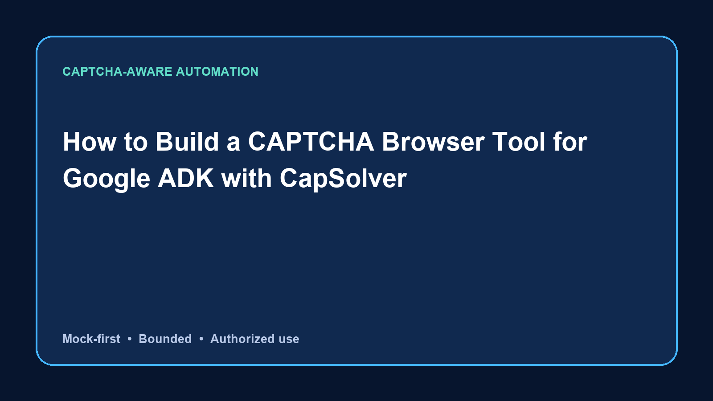

# How to Build a CAPTCHA Browser Tool for Google ADK with CapSolver



[English](../../README.md) · [简体中文](../zh-CN/README.md) · [日本語](../ja/README.md) · [Español](../es/README.md) · [Português](../pt-BR/README.md) · [한국어](../ko/README.md)

## Introduction

このリポジトリが解決する問題は「Google ADK tools need a clear contract for reporting CAPTCHA challenges without passing secrets or ambiguous browser output back to the agent」です。所有、モック、または明示的に許可された対象で [CapSolver](https://www.capsolver.com/?utm_source=github&utm_medium=referral&utm_campaign=google-adk-captcha-browser-tool-capsolver&utm_content=repository-readme) を接続し、回数制限と停止条件によって CAPTCHA ページを有効な結果と誤認しない方法を示します。

## Quick Start

```bash
python -m unittest discover -s tests -v
PYTHONPATH=src python examples/mock_workflow.py
```

## Responsible Use

公開データ、所有システム、または明示的に許可された対象だけで使用し、頻度、項目、保存期間を制限してください。機微情報がある場合は停止して人が確認します。

## Conclusion

この例はテスト可能でレビュー可能な実装です。Developer sharing CapSolver integration examples. 最後の製品リンクは [CapSolver](https://www.capsolver.com/?utm_source=github&utm_medium=referral&utm_campaign=google-adk-captcha-browser-tool-capsolver&utm_content=repository-readme) です。

## License

MIT
